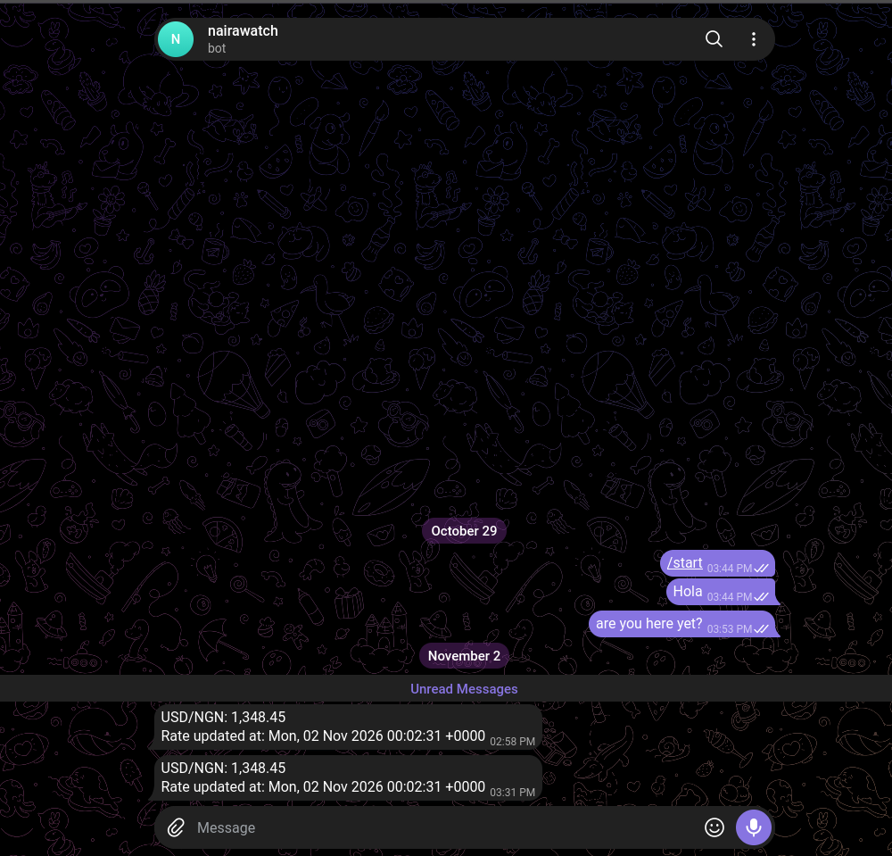

# Naira Watch

A small Python automation that fetches the current USD/NGN exchange rate once a day and sends it to me on Telegram. It runs on a schedule through GitHub Actions, so it works without my laptop being on.

> **Status:** Basic version (v0.1). Rate history, threshold alerts and tests are planned next (see [Roadmap](#roadmap)).



## What it does

1. Requests the latest USD rates from a free exchange-rate API.
2. Extracts the NGN rate and the time the source last updated it.
3. Formats a short message.
4. Sends it to a Telegram chat through a bot.

Example message:

```
USD/NGN: 1,512.40
Rate updated at: Wed, 28 Oct 2026 00:02:31 +0000
```

If the API request or the Telegram call fails, the script prints a short error message and exits with a failure code, so a broken run shows up as a red cross in GitHub Actions instead of passing silently.

## Important note about the data

The rate comes from a free API (open.er-api.com) and reflects the **official / mid-market rate**, not the parallel (street) market rate, which is often different in Nigeria. The source also refreshes roughly **once a day**, so the "updated at" time can look several hours old. This is expected.

Free APIs for parallel-market rates are scarce, and paid options exist. The code keeps fetching in a single function (`fetch_rate`), so the data source can be swapped later without changing the rest of the program.

## Tech stack

- Python 3
- [`requests`](https://requests.readthedocs.io/) for HTTP calls
- [`python-dotenv`](https://pypi.org/project/python-dotenv/) for loading local secrets
- Telegram Bot API for delivery
- GitHub Actions for scheduling

## Run it locally

**Prerequisites:** Python 3 and a Telegram bot (create one by messaging [@BotFather](https://t.me/BotFather) with `/newbot`).

```bash
git clone https://github.com/<your-username>/<your-repo>.git
cd <your-repo>

python3 -m venv venv
source venv/bin/activate        # on Windows: venv\Scripts\activate
pip install -r requirements.txt
```

Create a `.env` file in the project root (it is gitignored and must never be committed):

```
TELEGRAM_TOKEN=your-bot-token
TELEGRAM_CHAT_ID=your-chat-id
```

To find your chat ID, send any message to your bot, then open `https://api.telegram.org/bot<YOUR_TOKEN>/getUpdates` and read `chat` → `id`. Keep that URL private, since it contains your token.

Run it:

```bash
python3 main.py
```

## How the schedule works

The workflow in `.github/workflows/daily.yml` runs `main.py` on a cron schedule (currently **[HH:MM] UTC, which is [HH:MM] in Lagos**) and can also be started manually from the **Actions** tab using **Run workflow**.

GitHub's runner starts with an empty machine, so each run checks out the code, installs Python, installs the packages in `requirements.txt`, and then runs the script. Scheduled runs can start a few minutes late.

### Secrets

There is no `.env` file on GitHub. The bot token and chat ID are stored as repository secrets (**Settings → Secrets and variables → Actions**) named `TELEGRAM_TOKEN` and `TELEGRAM_CHAT_ID`, and the workflow passes them to the script as environment variables. The same code reads them from `.env` locally and from the environment on GitHub.

## Project structure

```
.
├── main.py                      # fetch, format and send logic
├── requirements.txt             # Python dependencies
├── .gitignore                   # keeps venv, caches and .env out of Git
└── .github/workflows/daily.yml  # scheduled GitHub Actions workflow
```

## Design decisions

- **Functions return results; the main block decides what to do.** `fetch_rate()` and `send_telegram()` report success or failure instead of exiting on their own, which keeps them reusable and easy to test later.
- **Secrets never appear in output.** Error messages from the Telegram call print only the error type, because the request URL contains the bot token.
- **Every network call has a timeout** and checks the HTTP status, so a slow or failing service cannot hang the run.


## Credits

Exchange rates from [ExchangeRate-API](https://www.exchangerate-api.com/) (open.er-api.com). Check their current terms for any attribution requirements before publishing.